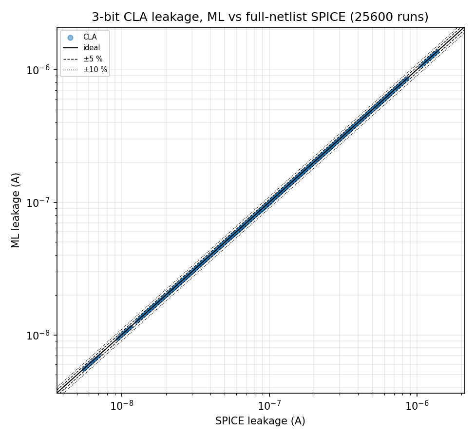
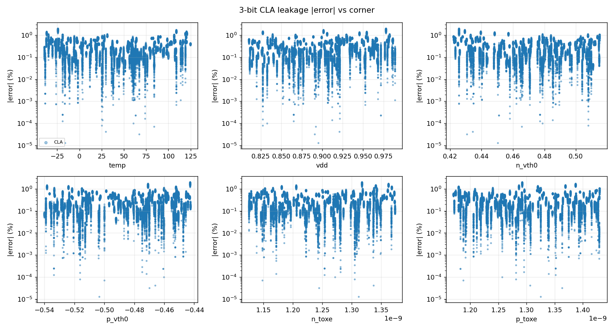

# Part C: test-circuit validation (3-bit carry-lookahead adder)

This part compares two leakage estimates for the assigned 3-bit CLA, at every input vector (A, B, Cin: 2^7 = 128) and the same 200 corners as Part B (25,600 runs):

- **SPICE:** the complete transistor netlist, `spice/cla3.cir`, written in ngspice.
- **Hierarchical ML:** a circuit model that calls the Part B gate models, which call the Part A transistor models.

## Results

25,600 runs (128 input vectors × 200 corners). Every SPICE output sat at its logic level and the adder adds correctly at every run. ngspice took 1,880 s; the hierarchical ML took about 2 s.

| Level | SPICE median | ML median | Bias | Median error | p95 error | Mean accuracy |
|---|---|---|---|---|---|---|
| **3-bit CLA, hierarchical ML (25,600 runs)** | 1.231e-07 A | 1.231e-07 A | +0.050 % | **0.25 %** | **0.86 %** | **99.67 %** |
| Gate level (Part B, all 18 cases) | 2.231e-09 A | 2.232e-09 A | +0.045 % | 0.26 % | 1.20 % | 99.61 % |

- **SPICE leakage range:** 5.49e-09 to 1.38e-06 A across the corners (median 1.231e-07 A).
- **Largest single error:** 2.05 %. The worst corner averages 1.7 % over its 128 vectors.
- **Composition error is negligible:** the sum of Part B's gate-level SPICE leakages matches the full netlist to a median 0.005 % (p95 0.027 %, bias −0.009 %). So the ~0.25 % CLA error is the ML models' own error, not an artefact of building the circuit from gates.
- **The circuit is no less accurate than one gate.** The median error matches the gate level, and the p95 error is lower (0.86 % vs 1.20 %). Summing 35 gates averages out part of their independent errors, and the bias stays near zero.
- **By carry-in:** Cin = 0: 99.68 %, Cin = 1: 99.66 %. All 128 vectors are between 99.64 % and 99.69 % mean accuracy.
- **Where the leakage is:** OR2 44 %, AND2 42 %, NAND2 11 %, INV 3 % of the ML leakage on average.

The full tables (per vector, best and worst vectors) are in [`results/cla_results_table.md`](results/cla_results_table.md); the plots are [`results/plots/cla_parity.png`](results/plots/cla_parity.png) and [`results/plots/cla_error_vs_corner.png`](results/plots/cla_error_vs_corner.png).





## How to run

Run Part B first. This part needs its `results/corners.csv` and `spice_gates.csv`.

```bash
cd part_c_circuit_level
python run_part_c.py            # ngspice on cla3.cir, then steps 1-3
```

Or run each piece by hand:

```bash
cd part_c_circuit_level/spice   # the netlist uses paths relative to this folder
ngspice_con -b cla3.cir         # 25,600 operating points in one process: about 31 min (≈9 s per corner)
cd ..
python step1_collect_spice_cla.py   # check + collect the ngspice output
python step2_ml_cla.py              # spec Step 7: hierarchical ML
python step3_evaluate_cla.py        # spec Step 8: table and plots
```

**Quick check:** set `let nrun = 5` in `spice/cla3.cir` and in the Part B netlists.

## What each file does and why it is needed

```
part_c_circuit_level/
├── README.md
├── run_part_c.py
├── step1_collect_spice_cla.py
├── step2_ml_cla.py
├── step3_evaluate_cla.py
├── spice/                      SPICE side (ngspice code)
│   └── cla3.cir
├── cla/                        Python side: the circuit level of the hierarchy
│   ├── __init__.py
│   ├── config.py
│   ├── circuit.py
│   └── hierarchy.py
└── results/                    everything the steps write (created on the first run)
```

Part C reuses Part B rather than duplicating it:
- **SPICE side:** `../part_b_gate_level/spice/gates.lib` (the gate subcircuits) and `models/45nm_HP_param.pm` (the corner-adjustable model card).
- **Python side:** `gatelib` (the gate model, transistor models, output parsing and metrics).

### SPICE side: `spice/`

**`cla3.cir`**
- **What:** the complete transistor-level netlist of the 3-bit CLA: 35 instances of the Part B gates, 186 transistors. It includes Part B's `gates.lib` and parameterised model card. Its `.control` script:
  1. draws the same 200 corners as the Part B netlists (identical corner block);
  2. applies each corner;
  3. sweeps all 128 input vectors (A2..A0, B2..B0, Cin) with each input at exactly 0 or VDD;
  4. after each operating point, writes the leakage, the VDD current and the four output voltages to `results/spice_cla.txt`.
- **Why:**
  - Spec Step 6 asks for the test circuit simulated as one complete netlist; this is the reference the hierarchical ML prediction is judged against.
  - It is also Deliverable 2's "netlist of your test circuit".
  - Building it from `gates.lib` means the CLA is made of exactly the gates validated in Part B.

### Python side: the step scripts

**`run_part_c.py`**
- **What:** the one command that runs Part C end to end. It runs `cla3.cir` with ngspice, then steps 1–3. `--skip-spice` reuses an earlier ngspice output.
- **Why:** it gives a fixed, reproducible order (Deliverable 9).

**`step1_collect_spice_cla.py`**
- **What:** reads `results/spice_cla.txt` and checks that:
  - `cla3.cir`'s gate instances match `cla/circuit.py`;
  - `gates.lib` matches `gatelib/gates.py`;
  - the gate network really adds (S + 8·C3 = A + B + Cin for all 128 vectors);
  - every SPICE output sits at its logic level;
  - the corners equal Part B's `corners.csv`.

  It writes `results/spice_cla.csv`.
- **Why:** the comparison is only meaningful if the netlist SPICE simulated is the circuit the ML side composes, and both use the same corners (spec: "the same 200 corners used in Part B").

**`step2_ml_cla.py`**
- **What:** for every input vector and corner, calls the hierarchical model (`CLAModel` → Part B `GateModel` → Part A transistor models) and records:
  - `ml_ileak`: the hierarchical ML leakage, using Part B's gate models with their pre-recorded gate node voltages (the result);
  - `spice_gatesum`: the sum of Part B's gate-level SPICE leakages, for the error analysis.

  It also records each gate type's share of the leakage, and writes `results/cla_results.csv`.
- **Why:**
  - This is the hierarchical ML prediction of spec Step 7.
  - `spice_gatesum` separates the error of composing gates (inputs not exactly at 0/VDD, loading between gates) from the error of the ML models themselves, which the report's error analysis needs.

**`step3_evaluate_cla.py`**
- **What:** compares the ML with the full-netlist SPICE and writes:
  - the results table (the same columns as Part B's: SPICE median, ML median, bias, median error, p95 error, mean accuracy), with Part B's overall gate-level row beside it;
  - for the error analysis: the composition check (SPICE gate sum vs full netlist), the per-vector metrics, the breakdown by carry-in, each gate type's share of the leakage, and the best and worst vectors;
  - the parity plot and the error-vs-corner plot.
- **Why:** it produces Deliverable 8 and the comparison with the gate-level accuracy the report asks for.

### Python side: the `cla/` package

**`config.py`**
- **What:** Part C paths. It also puts `part_b_gate_level` on Python's import path.
- **Why:** this lets Part C import Part B's `gatelib` (gate model, transistor models, metrics) instead of copying it.

**`circuit.py`**
- **What:** the CLA as data:
  - the list of 35 gate instances (type, input nets, output net), the same as the X cards in `cla3.cir`;
  - `simulate()`, which finds the logic value of every net, and therefore the input combination each gate sees, for an input vector;
  - `check_adder()` and `check_netlist()`.
- **Why:**
  - Spec Step 7 says: "for each input vector, determine the logic value at the inputs of every gate". This file does exactly that.
  - Its checks make sure it describes the same circuit as the netlist.

**`hierarchy.py`**
- **What:** `CLAModel`, the top level of the hierarchical ML. For an input vector it logic-simulates the circuit, asks the Part B gate model for each gate's leakage at that gate's inputs and corner, and sums the 35 values. Each distinct (gate, inputs) state is evaluated once and reused across instances and vectors.
- **Why:** this is the circuit → gate → transistor hierarchy the spec asks for. No circuit-level SPICE data enters the prediction.

**`__init__.py`**
- **What:** marks `cla` as a Python package.
- **Why:** so the step scripts can `import cla`.

### Outputs: `results/`

| File | What it is | Why it is needed |
|---|---|---|
| `spice_cla.txt` | raw ngspice output, one line per (corner, vector) | the SPICE reference as simulated |
| `spice_cla.csv` | the same as a checked table with the vector number, A, B, Cin and a logic check | input to step 2 |
| `cla_results.csv` | every run with SPICE, all ML variants, the gate-type shares and the corner parameters | the full record behind every table and plot, and the data for error analysis |
| `cla_results_table.md` / `.csv` | SPICE median, ML median, bias, median and p95 error, plus the gate-level row | **Deliverable 8** (table), and the comparison with gate-level accuracy |
| `cla_per_vector.csv` | the same metrics for each of the 128 input vectors | shows which input vectors are most and least accurate |
| `plots/cla_parity.png` | ML vs full-netlist SPICE, log axes | **Deliverable 8** (parity plot) |
| `plots/cla_error_vs_corner.png` | error vs temperature, VDD, vth0 and toxe | for the report's error-analysis section |
| `spice/cla3.log` | ngspice console output (written next to the netlist) | for debugging a failed run |

## Circuit

The CLA uses only the Part B gates from `gates.lib`: 35 gates, 186 transistors.

```
P_i = A_i XOR B_i      XOR(a,b) = AND2(NAND2(a,b), OR2(a,b))
G_i = INV(NAND2(A_i,B_i))      (shares the XOR's NAND2)
C1 = G0 + P0·C0
C2 = G1 + P1·G0 + P1·P0·C0
C3 = G2 + P2·G1 + P2·P1·G0 + P2·P1·P0·C0      (2-input AND2/OR2 trees)
S_i = P_i XOR C_i
```

The `.control` script uses the same corner block as the Part B netlists. It applies each corner (`alterparam` + `reset`, `option temp`, `alter vdd`), then sweeps the 7 inputs with nested `foreach` loops. Each `op` writes the leakage (`−I(VDD) − Σ bit·I(V_in)`), the VDD current and the four output voltages.

Step 1 runs several checks:
- `cla3.cir`'s X cards match `cla/circuit.py`;
- `gates.lib` matches `gatelib/gates.py`;
- the logic adds correctly (S + 8·C3 = A + B + Cin);
- every SPICE output sits at its logic level;
- the corners equal Part B's.

## Hierarchical ML (spec Step 7)

```
CLAModel.predict(vector, corners)                  cla/hierarchy.py
  ├─ logic-simulate the 35 gates -> the input bits each gate sees
  └─ for every gate: GateModel.predict(gate, bits, corners)    part_b_gate_level/gatelib/ml_gate.py
        └─ for every transistor: TransistorModels (NMOS/PMOS × ON/OFF)   Part A saved_models
  -> sum of the 35 gate leakages
```

Every gate input is taken at exactly 0 or VDD and loading between gates is ignored, as the spec states. Each distinct (gate, inputs) state is evaluated once per corner set and reused across instances and vectors.

The results compare these against the full-netlist SPICE:

| Column | What it is |
|---|---|
| `ml_ileak` | **main result:** gate models with the internal nodes pre-recorded by Part B's gate-level SPICE (spec Step 4) |
| `spice_gatesum` | sum of Part B's gate-level SPICE leakages: shows how much error comes from composing gates (inputs not exactly at the rails, loading) rather than from the ML models |
